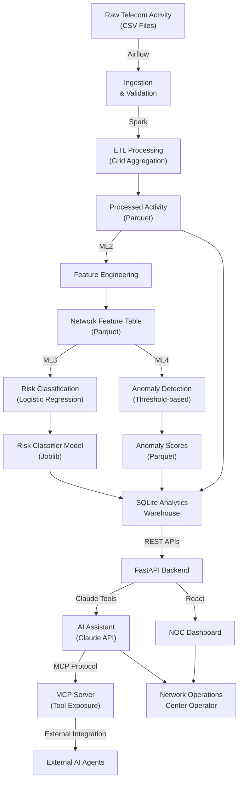

# Network Operations & Predictive Intelligence Platform
## Technical Implementation Documentation

**Version:** 1.0  
**Date:** September 2026  
**Status:** Comprehensive Implementation Guide  

---

## Table of Contents

1. [Executive Overview](#1-executive-overview)
2. [System Architecture](#2-system-architecture)
3. [Repository Structure](#3-repository-structure)
4. [Dataset & Data Contract](#4-dataset--data-contract)
5. [Development Environment & Setup](#5-development-environment--setup)
6. [Phase 1 - Core Python](#6-phase-1---core-python)
7. [Phase 2 - PySpark](#7-phase-2---pyspark)
8. [Phase 3 - Data Engineering & Airflow](#8-phase-3---data-engineering--airflow)
9. [Phase 4 - FastAPI Backend](#9-phase-4---fastapi-backend)
10. [Phase 5 - React NOC Dashboard](#10-phase-5---react-noc-dashboard)
11. [Phase 6 - Machine Learning](#11-phase-6---machine-learning)
12. [Phase 7 - Claude & AI-Assisted Operations](#12-phase-7---claude--ai-assisted-operations)
13. [End-to-End Integration](#13-end-to-end-integration)
14. [API & Data Interface Reference](#14-api--data-interface-reference)
15. [Configuration & Environment Variables](#15-configuration--environment-variables)
16. [Testing Strategy](#16-testing-strategy)
17. [Security](#17-security)
18. [Deployment & Operations](#18-deployment--operations)
19. [Troubleshooting](#19-troubleshooting)
20. [Implementation Gaps & Recommendations](#20-implementation-gaps--recommendations)
21. [Final Implementation Checklist](#21-final-implementation-checklist)

---

## 1. Executive Overview

### 1.1 Project Purpose

This repository contains a **Network Operations and Predictive Intelligence platform** for analyzing telecom network activity, identifying unusual patterns, generating network risk scores, and exposing network intelligence through APIs and a React dashboard.

The system provides:

- **Real-time network monitoring**: Ingestion and processing of telecom activity data
- **Predictive analytics**: ML-based risk classification and anomaly detection
- **Operational intelligence**: FastAPI backend exposing network metrics and insights
- **Interactive dashboard**: React NOC interface for network visualization and investigation
- **AI-assisted analysis**: Claude-based tools for intelligent network operations

### 1.2 Problem Being Solved

Network operations centers require:

1. **Rapid data processing**: Converting raw telecom activity into actionable intelligence
2. **Anomaly detection**: Identifying unusual network patterns automatically
3. **Risk assessment**: Predicting grids at risk of elevated activity
4. **Operational visibility**: Real-time dashboards for NOC operators
5. **Intelligent investigation**: AI-powered tools to understand network events

### 1.3 Core Objectives

| Objective | Implementation | Status |
|-----------|-----------------|--------|
| Ingest and validate telecom data | Airflow + Spark | ✅ Implemented |
| Process data into hourly grids | Spark ETL pipeline | ✅ Implemented |
| Generate ML features | Feature engineering pipeline | ✅ Implemented |
| Train risk classifier | Logistic regression model | ✅ Implemented |
| Detect anomalies | Anomaly detection engine | ✅ Implemented |
| Expose APIs | FastAPI service | ✅ Implemented |
| Visualize network | React dashboard | ✅ Implemented |
| AI-assisted operations | Claude integration | ✅ Implemented |
| MCP integration | Network intelligence tools | ✅ Implemented |

### 1.4 Technology Stack

```
Data Ingestion:    Apache Airflow
Processing:        Apache Spark (PySpark)
Storage:           Parquet files (Dataset/)
Analytics:         Python, Pandas, YAML
Machine Learning:  Scikit-learn, Joblib
API:               FastAPI, SQLAlchemy
Database:          SQLite (for dimension/fact tables)
Frontend:          React 19, Vite, Leaflet, Axios
Geographic:        GeoJSON (Milano grid reference)
AI Integration:    Claude API (Anthropic)
MCP Protocol:      Model Context Protocol
```

### 1.5 Scope & Capabilities

**Implemented Capabilities:**

- ✅ Telecom data ingestion pipeline
- ✅ Hourly grid aggregation (Milano grid reference)
- ✅ Network activity analysis
- ✅ Risk classification (high/low)
- ✅ Anomaly detection scoring
- ✅ Feature engineering (6 ML features)
- ✅ Batch risk scoring
- ✅ Network summary API
- ✅ Grid activity API
- ✅ Grid features API
- ✅ Hotspots & alerts API
- ✅ Risk prediction endpoint
- ✅ Pipeline status monitoring
- ✅ React dashboard with map visualization
- ✅ Claude AI assistant with tool use
- ✅ MCP integration for tool exposure
- ✅ Network intelligence investigation mode

**NOT Currently Implemented:**

- Real-time streaming (batch-only)
- Distributed model training at scale
- Advanced ML feature store
- Capacity planning features
- Customer impact modeling
- Root cause analysis automation
- Multi-regional support

### 1.6 Data Grain & Canonical Keys

**Canonical Analytical Grain:**

```
One grid per hourly timestamp
```

**Unique Analytical Key:**

```
(grid_id, timestamp)
```

All transformations, aggregations, and analytics respect this grain. Duplicate records are detected and reported as data quality violations.

---

## 2. System Architecture

### 2.1 High-Level Data Flow

```
Raw Telecom Activity (CSV)
        ↓
Airflow Ingestion & Validation
        ↓
Spark ETL Processing
        ↓
Processed Activity (Parquet)
        ↓
Feature Engineering (ML2)
        ↓
Feature Table (Parquet)
        ↓
Model Training & Anomaly Detection (ML3, ML4)
        ↓
Risk Scores & Anomalies (Parquet)
        ↓
SQLite Analytics Warehouse
        ↓
FastAPI Backend
        ↓
React Frontend / Claude Layer
        ↓
NOC Operator / AI Assistant
```

### 2.2 Architecture Diagram



### 2.3 Component Interaction

**Data Pipeline:**
- Airflow orchestrates daily/hourly runs
- Spark processes raw CSV into hourly grid aggregations
- Processed data written to parquet for persistence
- ML pipeline ingests processed data for feature generation

**Analytics Layer:**
- Dimension tables (DimTime, DimGrid) in SQLite
- Fact table (FactNetworkActivity) stores hourly metrics
- APIs query this warehouse for real-time responses

**ML Pipeline:**
- ML2: Generates 6 features from hourly activity
- ML3: Trains risk classifier on historical patterns
- ML4: Detects anomalies using activity thresholds
- ML6: Batch scores all grids with trained model

**Frontend & AI:**
- React dashboard consumes FastAPI endpoints
- Claude Layer provides intelligent investigation
- MCP Server exposes tools for external use
- Backend services contain business logic (not duplicated)

### 2.4 Data Flow Timeline

```
T0: Raw data arrives
  ↓
T1: Airflow triggers ingestion
  ↓
T2: Spark processes into hourly grids
  ↓
T3: Data written to analytics storage
  ↓
T4: SQLite warehouse loaded
  ↓
T5: ML2 features generated
  ↓
T6: ML3 risk scores computed
  ↓
T7: ML4 anomalies detected
  ↓
T8: ML6 batch scoring applied
  ↓
T9: APIs expose latest intelligence
  ↓
T10: Dashboard & Claude access results
```

---

## 3. Repository Structure

### 3.1 Complete Directory Layout

```
Project 2/
├── Dataset/                           # Data storage (all grain levels)
│   ├── analytics/                     # Final analytics output
│   │   ├── ML_LAYER/
│   │   │   ├── anomaly_detection/     # ML4 output
│   │   │   ├── network_risk_scores/   # ML6 output
│   │   │   ├── risk_classifier/       # ML3 model artifact
│   │   │   ├── network_feature_table.parquet
│   │   │   └── hourly_grid_summary.parquet
│   │   ├── hourly_grid_summary.parquet
│   │   ├── DE7/
│   │   │   └── quality_check_status.json
│   │   └── ML_LAYER/
│   ├── landing/                       # Raw ingested data
│   ├── processed/                     # Spark ETL output
│   │   └── activity/
│   ├── raw/                           # Raw CSV input
│   ├── reference/                     # Reference data (e.g., milano-grid.geojson)
│   └── SP2/                           # Spark Phase 2 output
│
├── Phase 1/                           # Core Python implementations
│   ├── np2/                           # Usage processor (Phase 1, objective 2)
│   │   └── usage_processor.py
│   └── np3/                           # Alert detector (Phase 1, objective 3)
│       └── alert_detector.py
│
├── Phase 2/                           # PySpark implementations
│   ├── SP7/
│   │   └── telecom_pipeline.py
│   └── ...
│
├── Phase 3/                           # Data Engineering work
│   ├── DE 6/
│   │   ├── check.py
│   │   └── upload.py
│   ├── DE 6 Batch vs Streaming.md
│   └── ...
│
├── Phase 6/                           # Machine Learning
│   └── ...
│
├── Phase 7/                           # Claude & AI Operations
│   └── ...
│
├── Project Workflow/                  # Project management & guides
│   └── Phase 1 Project - Network Operations Predictive Intelligence - Trainer Guide 1.pdf
│
├── experiments/                       # Experimental code
│   └── c16_context_comparision.py
│
├── src/                               # Primary source code
│   ├── AirFlow/                       # Airflow DAGs & orchestration
│   │   ├── dags/
│   │   │   ├── Phase3/
│   │   │   │   ├── DE2/               # Ingestion DAG
│   │   │   │   │   └── ingestion.py
│   │   │   │   ├── DE3/               # Telecom pipeline
│   │   │   │   │   └── telecom_pipeline.py
│   │   │   │   ├── DE7/               # Quality check service
│   │   │   │   │   └── de7_pipeline_service.py
│   │   │   │   ├── DE8/               # Analytics load service
│   │   │   │   │   └── de8_pipeline_service.py
│   │   │   │   └── __init__.py
│   │   │   ├── extended_pipeline.py
│   │   │   ├── hello_airflow.py
│   │   │   ├── ingestion_dag.py
│   │   │   ├── quality_pipeline.py
│   │   │   ├── telecom_pipeline_dag.py
│   │   │   └── __init__.py
│   │   └── data/                      # Local data directories for Airflow
│   │       ├── raw/
│   │       ├── processed/
│   │       └── analytics/
│   │
│   ├── Backend/                       # FastAPI application
│   │   ├── main.py                    # FastAPI app initialization
│   │   ├── database.py                # SQLAlchemy setup
│   │   ├── models.py                  # Pydantic response models
│   │   ├── schemas.py                 # SQLAlchemy ORM schemas
│   │   ├── routes/
│   │   │   ├── network.py             # Network intelligence endpoints
│   │   │   └── assistant.py           # Claude assistant endpoints
│   │   └── service/
│   │       ├── service.py             # Network service logic
│   │       ├── assistant.py           # Assistant service logic
│   │       └── cost.py                # Cost tracking service
│   │
│   ├── Frontend/                      # React application
│   │   ├── src/
│   │   │   ├── App.jsx                # Main app component
│   │   │   ├── main.jsx               # Entry point
│   │   │   ├── Pages/
│   │   │   │   └── Dashboard/         # Main dashboard page
│   │   │   ├── components/
│   │   │   │   ├── NetworkSummary/    # Summary statistics component
│   │   │   │   ├── NetworkGrid/       # Grid detail view
│   │   │   │   ├── HotspotAndGrid/    # Hotspot visualization
│   │   │   │   └── Predict/           # Risk prediction component
│   │   │   └── api/                   # API client utilities
│   │   ├── package.json
│   │   ├── vite.config.js
│   │   └── public/
│   │
│   ├── ML Layer/                      # Machine Learning components
│   │   ├── features.py                # ML2: Feature engineering
│   │   ├── classifier.py              # ML3: Risk classification
│   │   ├── anamoly_detector.py        # ML4: Anomaly detection
│   │   ├── batch_score.py             # ML6: Batch risk scoring
│   │   ├── print_features.py          # Utility for feature inspection
│   │   └── config.yaml                # ML configuration
│   │
│   ├── Claude_Layer/                  # Claude AI integration
│   │   ├── claude_insight.py          # Main Claude interaction
│   │   ├── context/
│   │   │   └── long_context.py        # Context management
│   │   └── tools/
│   │       ├── tools_definition.py    # Claude tool definitions
│   │       ├── tools_description.py   # Tool descriptions
│   │       └── tool_executor.py       # Tool execution logic
│   │
│   ├── mcp-server/                    # MCP Protocol implementation
│   │   ├── server.py                  # MCP server (FastMCP)
│   │   ├── api_client.py              # HTTP client for APIs
│   │   ├── config.py                  # MCP configuration
│   │   └── validation.py              # Input validation
│   │
│   ├── usage_processor.py             # Root-level utility (Phase 1)
│   ├── alert_detector.py              # Root-level utility (Phase 1)
│   └── __init__.py
│
├── noc-agent/                         # NOC Agent implementation
│   ├── agent.py                       # Agent logic
│   ├── models.py                      # Agent models
│   ├── config.py                      # Agent configuration
│   └── requirements.txt
│
├── .claude/                           # Claude Code configuration
│   ├── settings.json                  # Claude Code settings
│   ├── settings.local.json            # Local overrides
│   ├── agents/                        # Custom agents
│   ├── skills/                        # Custom skills
│   └── plugins/
│
├── .claude-plugin/                    # Plugin configuration
│   └── plugin.json
│
├── .mcp.json                          # MCP server configuration
├── CLAUDE.md                          # Project rules & guidelines
├── Claude.md                          # (backup/alternative)
├── repository-map.md                  # Repository overview
├── missing-tests.md                   # Known testing gaps
├── DECODEML.ipynb                     # ML analysis notebook
│
├── docs/                              # Documentation
│   ├── ai1-model-selection.md         # AI model selection guide
│   ├── context-cost-guideline.md      # Context optimization
│   └── ...
│
├── log/                               # Log files
│   ├── ml2_features.log
│   ├── ml3_classifier.log
│   ├── ml4_anomaly.log
│   └── ml6_batch_scoring.log
│
└── experiments/                       # Experimental code
    └── c16_context_comparision.py     # Context comparison tests
```

### 3.2 Directory Responsibilities

**Dataset/**
- Stores all data in parquet format (immutable landing/raw)
- Analytics output organized by data type (ML_LAYER/, hourly_grid_summary/)
- Reference data for geographic enrichment
- Quality check status files

**src/AirFlow/**
- Orchestrates data pipeline execution
- Manages task dependencies and scheduling
- Local data directories for pipeline artifacts
- Handles failures and retries

**src/Backend/**
- FastAPI application serving network intelligence APIs
- SQLAlchemy ORM for database interactions
- Pydantic models for request/response validation
- Service layer containing business logic

**src/Frontend/**
- React application for NOC dashboard
- Component-based UI (NetworkSummary, NetworkGrid, Hotspots, Predictions)
- API client for backend communication
- Map visualization using Leaflet

**src/ML Layer/**
- Feature engineering pipeline (ML2)
- Risk classifier training (ML3)
- Anomaly detection (ML4)
- Batch scoring engine (ML6)
- Configuration management via YAML

**src/Claude_Layer/**
- Claude API integration
- Tool definitions & execution
- Context management for long conversations
- System prompts for NOC operations

**src/mcp-server/**
- FastMCP server implementation
- Tool exposure for external use
- Input validation
- HTTP client for backend APIs

---

## 4. Dataset & Data Contract

### 4.1 Data Sources

**Primary Source:**
- Telecom network activity CSV files
- Grid-based location data (Milano reference grid)
- Historical activity patterns for baseline generation

**Storage Zones:**

```
Raw Data       → /Dataset/raw/                (Immutable)
Landing Area   → /Dataset/landing/            (Validated)
Processed      → /Dataset/processed/activity/ (ETL output)
Analytics      → /Dataset/analytics/          (Final intelligence)
ML Outputs     → /Dataset/analytics/ML_LAYER/ (Model results)
Reference      → /Dataset/reference/          (GeoJSON, lookups)
```

### 4.2 Data Schema

**Activity Record (Input)**

| Field | Type | Description | Rules |
|-------|------|-------------|-------|
| timestamp | DateTime | Event time (hourly) | Required, UTC |
| cellId | Integer | Geographic cell ID | Maps to grid_id |
| sms_in | Numeric | Inbound SMS activity | ≥ 0, represents activity measure |
| sms_out | Numeric | Outbound SMS activity | ≥ 0, represents activity measure |
| call_in | Numeric | Inbound call activity | ≥ 0, represents activity measure |
| call_out | Numeric | Outbound call activity | ≥ 0, represents activity measure |
| internet_activity | Numeric | Internet usage measure | ≥ 0, represents activity measure |

**Note on Activity Values:**
Activity values are **activity measures**, not:
- Customer counts
- Message counts
- Data volume (MB)
- Confirmed traffic volume
- User counts

The source dataset defines the meaning; this implementation preserves that definition.

**Processed Record (Output - Hourly Grain)**

| Field | Type | Description |
|-------|------|-------------|
| timestamp | DateTime | Hour boundary (UTC) |
| grid_id | Integer | Geographic grid identifier |
| sms_in | Numeric | Hour total |
| sms_out | Numeric | Hour total |
| call_in | Numeric | Hour total |
| call_out | Numeric | Hour total |
| internet_activity | Numeric | Hour total |
| total_activity | Numeric | Sum of all activities |

**Grain Enforcement:**
- Unique key: `(grid_id, timestamp)`
- Duplicates detected as data quality violations
- No null values allowed for required fields
- Timestamps aligned to hour boundaries

### 4.3 ML Feature Table

**ML2 Feature Generation:**

| Feature | Calculation | Window | Purpose |
|---------|-------------|--------|---------|
| avg_activity | Mean(total_activity) | 24-hour recent | Baseline activity level |
| activity_growth | (Latest - Baseline) / Baseline | Recent vs baseline | Growth trend |
| active_hours | Count(activity > 0) | 24-hour | Activity frequency |
| peak_ratio | Max(activity) / Avg(activity) | 24-hour | Activity volatility |
| variability | Stddev(activity) / Mean(activity) | 24-hour | Activity consistency |
| internet_share | Total(internet) / Total(all) | 24-hour | Internet component |

**Minimum History Required:** 48 hours
**Recent Window:** 24 hours (features)
**Baseline Window:** 24 hours (prior to features)

**Key Rules:**
- No future data in features (no data leakage)
- Features computed at feature_timestamp
- Baseline excludes current observation
- Missing hours filled with zeros

### 4.4 ML Labels

**Risk Label (ML3):**

```
HIGH RISK = Grid in top 10% activity growth in next hour
LOW RISK = Grid below 90th percentile
```

**Trained Horizon:** 1 hour ahead
**Data Split:** 80% train, 20% test
**Baseline Calculation:** Historical hour patterns excluding current period

### 4.5 Reference Data

**Milano Grid Reference**
- Location: `/Dataset/reference/milano-grid.geojson`
- Format: GeoJSON with cell features
- Key Field: `properties.cellId` → maps to `grid_id`
- Grid Count: ~10,000 geographic cells
- Usage: Geographic enrichment, visualization

### 4.6 Data Validation Rules

**Grain Check:**
- Unique (grid_id, timestamp) combinations
- No duplicate hourly records per grid
- All grids have hourly records for same timestamp range

**Activity Rules:**
- All activity fields ≥ 0 (non-negative)
- total_activity = sms_in + sms_out + call_in + call_out + internet_activity
- No null values in core activity fields

**Timestamp Rules:**
- Timestamps in UTC
- Aligned to hour boundaries (00:00, 01:00, ...)
- No gaps in time series (continuous hourly records)

**Quality Metrics:**
- Rejection Rate: < 15% (rows rejected / rows published)
- Completeness: All required fields populated
- Timeliness: Latest data < 3 hours old (stale) or < 1 hour (fresh)

---

## 5. Development Environment & Setup

### 5.1 Prerequisites

**Python:**
- Python 3.9+
- Virtual environment (venv or conda)

**Java:**
- Java 11+ (required for Spark)
- JAVA_HOME environment variable

**Node.js:**
- Node.js 18+
- npm or yarn

**External Services:**
- Apache Airflow (local or container)
- SQLite3 (included with Python)
- Claude API key (for AI features)

### 5.2 Python Environment Setup

```bash
# Navigate to project directory
cd "D:\Training Project\Project 2"

# Create virtual environment
python -m venv venv

# Activate virtual environment
# On Windows:
venv\Scripts\activate
# On macOS/Linux:
source venv/bin/activate

# Install dependencies
pip install -r requirements.txt
```

**Key Python Packages:**

```
fastapi==0.104.0
sqlalchemy==2.0.0
pandas==2.1.0
pyspark==3.5.0
scikit-learn==1.3.0
joblib==1.3.0
anthropic==0.7.0
pydantic==2.0.0
python-dotenv==1.0.0
pyyaml==6.0
pytest==7.4.0
```

### 5.3 Configuration Files

**Environment Variables (.env):**

```bash
# Claude API
ANTHROPIC_API_KEY=sk-ant-...your-key...
ANTHROPIC_MODEL=claude-3-5-sonnet-20241022

# Backend
DATABASE_URL=sqlite:///analytics.db
BACKEND_PORT=8000

# Spark (optional)
SPARK_HOME=/path/to/spark
PYSPARK_PYTHON=python

# Data Paths (Relative to repo root)
RAW_DATA_PATH=Dataset/raw/
PROCESSED_PATH=Dataset/processed/
ANALYTICS_PATH=Dataset/analytics/
REFERENCE_PATH=Dataset/reference/milano-grid.geojson
```

**ML Configuration (src/ML Layer/config.yaml):**

```yaml
ml2:
  input_path: "../../Dataset/analytics/hourly_grid_summary.parquet"
  output_path: "../../Dataset/analytics/ML_LAYER/network_feature_table.parquet"
  feature:
    recent_window_hours: 24
    baseline_window_hours: 24
    minimum_history_hours: 48

ml3:
  feature_path: "../../Dataset/analytics/ML_LAYER/network_feature_table.parquet"
  output_path: "../../Dataset/analytics/ML_LAYER/risk_classifier"
  split:
    train_ratio: 0.8
  model:
    type: "logistic_regression"
    max_iter: 1000

ml4:
  input_path: "../../Dataset/analytics/hourly_grid_summary.parquet"
  output_path: "../../Dataset/analytics/ML_LAYER/anomaly_detection"
  anomaly:
    percentage_threshold: 50

ml6:
  feature_path: "../../Dataset/analytics/ML_LAYER/network_feature_table.parquet"
  model_path: "../../Dataset/analytics/ML_LAYER/risk_classifier/risk_classifier.joblib"
  output_path: "../../Dataset/analytics/ML_LAYER/network_risk_scores"
  scoring:
    threshold: 0.5
```

### 5.4 Backend Startup

```bash
# Navigate to backend directory
cd src/Backend

# Run FastAPI
uvicorn main:app --reload --port 8000

# API will be available at:
# - http://localhost:8000/docs (Swagger UI)
# - http://localhost:8000/redoc (ReDoc)
```

**Key Startup Checks:**

1. Database file created at `analytics.db`
2. Tables created in database
3. Parquet files readable from Dataset/
4. Port 8000 available

### 5.5 Frontend Startup

```bash
# Navigate to frontend directory
cd src/Frontend

# Install dependencies (first time only)
npm install

# Start development server
npm run dev

# Application will be available at:
# http://localhost:5173
```

**Frontend Port:** 5173 (Vite default)
**CORS Configuration:** Configured to accept requests from localhost:5173

### 5.6 Airflow Setup

```bash
# Initialize Airflow home
export AIRFLOW_HOME=$(pwd)/src/AirFlow

# Initialize database
airflow db init

# Create admin user
airflow users create \
  --username admin \
  --password admin \
  --firstname Admin \
  --lastname User \
  --role Admin \
  --email admin@example.com

# Start web server
airflow webserver --port 8080

# Start scheduler (separate terminal)
airflow scheduler
```

**Airflow UI:** http://localhost:8080

### 5.7 Claude Integration Setup

```bash
# Set API key in .env
ANTHROPIC_API_KEY=sk-ant-...your-key...
ANTHROPIC_MODEL=claude-3-5-sonnet-20241022

# Test Claude integration
cd src/Claude_Layer
python claude_insight.py

# Should output network analysis for Grid 4821
```

### 5.8 Data Preparation

1. **Place raw data** in `Dataset/raw/` as CSV files
2. **Run ingestion** via Airflow DAG or directly:
   ```bash
   python src/AirFlow/dags/Phase3/DE2/ingestion.py
   ```
3. **Run Spark pipeline** for hourly aggregation:
   ```bash
   python src/AirFlow/dags/Phase3/DE3/telecom_pipeline.py
   ```
4. **Load to SQLite** (auto-run by FastAPI on startup)
5. **Generate features** (ML2):
   ```bash
   cd src/ML\ Layer
   python features.py
   ```

### 5.9 System Health Check

```bash
# Verify all components
# 1. Check Python environment
python --version  # Should be 3.9+

# 2. Check Spark
pyspark --version  # Should be 3.5.0+

# 3. Check data files
ls Dataset/analytics/*.parquet

# 4. Check database
sqlite3 src/Backend/analytics.db ".tables"

# 5. Test backend
curl http://localhost:8000/network/summary

# 6. Test frontend
# Open http://localhost:5173 in browser

# 7. Test Claude
cd src/Claude_Layer && python claude_insight.py
```

---

## 6. Phase 1 - Core Python

### 6.1 Objective

Establish foundational Python utilities for telecom data processing and anomaly detection, including:
- Usage data processing with validation
- Rule-based alert generation
- Data profiling and inspection

### 6.2 UsageProcessor (NP2)

**Location:** `Phase 1/np2/usage_processor.py`

**Purpose:** Validate and process telecom usage data from source format to standardized structure.

**Key Responsibilities:**
- Load CSV data from raw sources
- Validate data schema and types
- Clean and normalize values
- Calculate derived fields (totals, shares)
- Export to parquet for downstream consumption

**Implementation:**

```python
# Pseudocode structure
class UsageProcessor:
    def __init__(self, input_path, output_path):
        self.input_df = pd.read_csv(input_path)
        
    def validate(self):
        # Check required columns
        # Check data types
        # Check for nulls
        # Check value ranges
        
    def process(self):
        # Clean values
        # Calculate totals
        # Generate timestamps
        # Align to hourly grain
        
    def save(self):
        # Write to parquet
        # Create metadata
```

**Processed Output Schema:**
- timestamp: Aligned to hour boundary
- grid_id: From cellId
- sms_in, sms_out, call_in, call_out, internet_activity
- total_activity: Sum of all activities

**Testing:**
- Schema validation
- Null handling
- Type coercion
- Grain alignment

### 6.3 AlertDetector (NP3)

**Location:** `Phase 1/np3/alert_detector.py`

**Purpose:** Identify network anomalies using rule-based logic on activity patterns.

**Key Rules:**

```
CRITICAL ALERT:  total_activity >= 10,000
HIGH ALERT:      total_activity >= 5,000
MEDIUM ALERT:    total_activity >= 1,000
LOW/NORMAL:      total_activity < 1,000
```

**Alert Attributes:**
- grid_id
- timestamp
- activity_level
- alert_severity
- alert_reason
- recommendation

**Implementation Logic:**
1. Query processed activity for recent hours
2. Calculate hourly totals by grid
3. Compare against threshold rules
4. Generate alerts for violations
5. Store in landing area for downstream processing

**Output Format:**
```csv
timestamp,grid_id,alert_severity,total_activity,reason
2024-09-15 12:00:00,4821,HIGH,5500,High network activity detected
2024-09-15 12:00:00,3456,CRITICAL,12000,Extremely high network activity
```

**Connection to Downstream:**
- Alerts feed into ML3 for label generation
- Historical alerts inform baseline calculations
- Alert patterns identify recurring hotspots

### 6.4 Data Profiling Utilities

**Purpose:** Understand data characteristics and quality

**Metrics Calculated:**
- Record count by timestamp
- Activity distribution (min, max, mean, median, std)
- Grid coverage (grids with data vs. expected)
- Time coverage (contiguous hours)
- Null/zero frequency
- Anomaly patterns

**Output:** Profile reports in JSON/Parquet for documentation

---

## 7. Phase 2 - PySpark

### 7.1 Objective

Implement distributed data processing using Spark to scale from single-machine to production:
- Ingest raw CSV in distributed manner
- Clean and validate at scale
- Aggregate to hourly grid grain
- Enrich with geographic reference data
- Output partitioned parquets for consumption

### 7.2 Spark Pipeline (SP2)

**Location:** `Phase 2/SP7/telecom_pipeline.py` (also replicated in Phase 3 DAGs)

**High-Level Flow:**

```
CSV Files (Raw)
    ↓
Spark Read (RDD/DataFrame)
    ↓
Schema Validation
    ↓
Data Cleaning
    ↓
Type Conversion
    ↓
Hour Alignment
    ↓
Grid Aggregation
    ↓
Geographic Enrichment (Optional)
    ↓
Parquet Write (Partitioned)
    ↓
Output: hourly_grid_summary.parquet
```

### 7.3 Key Spark Jobs

**Job 1: Ingestion & Validation**

```python
# Read raw CSV
df = spark.read.csv(
    path="Dataset/raw/*.csv",
    header=True,
    inferSchema=True
)

# Select and rename columns
df = df.select(
    F.col("timestamp").cast("timestamp"),
    F.col("cellId").cast("long").alias("grid_id"),
    F.col("sms_in").cast("double"),
    F.col("sms_out").cast("double"),
    # ... other fields
)

# Validate schema
assert "grid_id" in df.columns
assert "timestamp" in df.columns
assert "sms_in" in df.columns
```

**Job 2: Hourly Aggregation**

```python
# Hour alignment
df = df.withColumn(
    "hour_timestamp",
    F.date_trunc("hour", F.col("timestamp"))
)

# Group by grid + hour
hourly = df.groupBy(
    F.col("grid_id"),
    F.col("hour_timestamp").alias("timestamp")
).agg(
    F.sum(F.col("sms_in")).alias("sms_in"),
    F.sum(F.col("sms_out")).alias("sms_out"),
    F.sum(F.col("call_in")).alias("call_in"),
    F.sum(F.col("call_out")).alias("call_out"),
    F.sum(F.col("internet_activity")).alias("internet_activity")
)

# Calculate totals
hourly = hourly.withColumn(
    "total_activity",
    F.col("sms_in") + F.col("sms_out") + 
    F.col("call_in") + F.col("call_out") + 
    F.col("internet_activity")
)
```

**Job 3: Duplicate Detection**

```python
# Check grain
window_spec = Window.partitionBy(
    "grid_id", "timestamp"
)

duplicates = df.withColumn(
    "row_num",
    F.row_number().over(window_spec)
).filter(
    F.col("row_num") > 1
)

if duplicates.count() > 0:
    raise ValueError(
        f"Grain violation: {duplicates.count()} duplicate records found"
    )
```

**Job 4: Output Writing**

```python
hourly.write \
    .mode("overwrite") \
    .format("parquet") \
    .partitionBy("timestamp") \
    .save("Dataset/processed/activity")
```

### 7.4 Geographic Enrichment

**Optional enrichment with Milano grid reference:**

```python
# Load GeoJSON
geojson = spark.read.json(
    "Dataset/reference/milano-grid.geojson"
)

# Extract grid properties
grids = geojson.select(
    F.col("properties.cellId").cast("long").alias("grid_id"),
    F.col("properties.latitude"),
    F.col("properties.longitude"),
    F.col("geometry")
)

# Join with activity
enriched = hourly.join(
    grids,
    on="grid_id",
    how="left"
)
```

### 7.5 Performance Considerations

**Partitioning Strategy:**
- Partition by hour (timestamp) for time-series queries
- Coalesce small partitions to reduce file count
- Use `repartition()` for balanced distribution

**Resource Requirements:**
- Worker nodes: 4GB+ RAM
- Executors: 2-4 per node
- Parallelism: 100-200 tasks

**Optimization:**
- Cache frequently accessed dataframes
- Use broadcast joins for dimension tables
- Implement column selection early
- Monitor task duration and shuffle size

---

## 8. Phase 3 - Data Engineering & Airflow

### 8.1 Objectives

Orchestrate the complete data pipeline using Airflow:
- Schedule regular ingestion runs
- Manage task dependencies
- Handle failures and retries
- Monitor pipeline health
- Produce quality reports

### 8.2 Data Architecture

**Storage Layers:**

```
Raw → Landing → Processed → Analytics → ML Outputs
```

**Zones:**

| Zone | Purpose | Format | Lifecycle |
|------|---------|--------|-----------|
| Raw | Immutable source | CSV | Indefinite |
| Landing | Validated input | CSV/Parquet | 30 days |
| Processed | ETL output | Parquet | Indefinite |
| Analytics | Ready for consumption | Parquet | Current |
| ML | Model inputs/outputs | Parquet/Joblib | Current |

### 8.3 Airflow DAGs

**Main DAG:** `src/AirFlow/dags/telecom_pipeline_dag.py`

**Schedule:** Daily or hourly (configurable)

**Tasks:**

```
ingestion_task
    ↓
validate_task
    ↓
spark_processing_task
    ↓
data_quality_task
    ↓
analytics_load_task
```

**DAG Configuration:**

```python
from airflow import DAG
from datetime import datetime, timedelta

default_args = {
    'owner': 'data-engineering',
    'retries': 2,
    'retry_delay': timedelta(minutes=5),
    'email_on_failure': True,
}

dag = DAG(
    'telecom_pipeline',
    default_args=default_args,
    description='Telecom data pipeline',
    schedule_interval='@hourly',  # or '0 0 * * *' for daily
    start_date=datetime(2024, 1, 1),
)
```

### 8.4 Task Implementations

**DE2 - Ingestion:**

```python
# src/AirFlow/dags/Phase3/DE2/ingestion.py

def ingestion_task():
    """
    Load raw CSV files into landing area.
    Check file existence and format.
    """
    raw_path = "Dataset/raw/"
    files = [f for f in os.listdir(raw_path) if f.endswith(".csv")]
    
    if not files:
        raise FileNotFoundError(f"No CSV files in {raw_path}")
    
    # Copy to landing
    for file in files:
        shutil.copy(
            os.path.join(raw_path, file),
            os.path.join("Dataset/landing/", file)
        )
    
    return len(files)
```

**DE3 - Spark Processing:**

```python
# src/AirFlow/dags/Phase3/DE3/telecom_pipeline.py

def spark_processing_task():
    """
    Run Spark ETL pipeline to produce hourly aggregations.
    """
    spark = SparkSession.builder \
        .appName("TelecomPipeline") \
        .getOrCreate()
    
    # Load, validate, aggregate, write
    df = spark.read.csv("Dataset/landing/*.csv", header=True)
    # ... transformation logic
    df.write.mode("overwrite") \
        .parquet("Dataset/processed/activity")
```

**DE7 - Quality Check:**

```python
# src/AirFlow/dags/Phase3/DE7/de7_pipeline_service.py

def quality_check_task():
    """
    Validate data quality and generate health report.
    """
    # Load processed data
    df = pd.read_parquet("Dataset/processed/activity")
    
    # Check grain
    grain_check = df.groupby(['grid_id', 'timestamp']).size()
    duplicates = (grain_check > 1).sum()
    
    if duplicates > 0:
        raise ValueError(f"{duplicates} duplicate records")
    
    # Check completeness
    null_count = df.isnull().sum().sum()
    rejection_rate = df['rejected'].sum() / len(df)
    
    # Generate report
    status = {
        'overall_status': 'PASS' if duplicates == 0 else 'FAIL',
        'timestamp': datetime.utcnow().isoformat(),
        'tasks': [
            {
                'task_name': 'Grain Validation',
                'status': 'PASS' if duplicates == 0 else 'FAIL',
                'rows_published': len(df),
                'rows_rejected': duplicates
            }
        ]
    }
    
    # Write status to JSON
    with open('Dataset/analytics/DE7/quality_check_status.json', 'w') as f:
        json.dump(status, f)
```

**DE8 - Analytics Load:**

```python
# src/AirFlow/dags/Phase3/DE8/de8_pipeline_service.py

def analytics_load_task():
    """
    Load processed data into SQLite analytics warehouse.
    """
    df = pd.read_parquet("Dataset/processed/activity")
    
    # Connect to SQLite
    engine = create_engine("sqlite:///analytics.db")
    Base.metadata.create_all(engine)
    
    # Load fact table
    session = Session(engine)
    
    for _, row in df.iterrows():
        activity = FactNetworkActivity(
            grid_id=row['grid_id'],
            timestamp=row['timestamp'],
            sms_in=row['sms_in'],
            # ... other fields
        )
        session.add(activity)
    
    session.commit()
```

### 8.5 Idempotency & Error Handling

**Idempotent Design:**

Each task written to be safe to rerun:

```python
# Use "overwrite" mode for deterministic output
df.write.mode("overwrite").parquet(output_path)

# Or use "append" with upsert logic
session.query(FactNetworkActivity) \
    .filter_by(grid_id=grid_id, timestamp=ts) \
    .delete()
session.add(new_record)
```

**Retry Policy:**

```
Max Retries: 2
Retry Delay: 5 minutes
Exponential Backoff: Off
```

**Failure Handling:**

- Failed tasks: Email notification to owner
- Downstream tasks: Skipped until failure resolved
- Manual retry via UI or CLI

### 8.6 Data Quality Metrics

**Metrics Tracked:**

1. **Grain Integrity**
   - Unique (grid_id, timestamp) records
   - No duplicates or splits

2. **Completeness**
   - Null values in required fields
   - Missing grids
   - Missing hours

3. **Freshness**
   - Time since last run
   - Data lag (now - latest_timestamp)
   - SLA: Data < 1 hour old

4. **Rejection Rate**
   - Rows rejected / rows published
   - Alert if > 15%

5. **Pipeline Health**
   - Task success rate
   - Average task duration
   - Failure patterns

---

## 9. Phase 4 - FastAPI Backend

### 9.1 Purpose & Architecture

Expose network intelligence through REST APIs consumed by:
- React frontend
- Claude Layer
- MCP Server
- External tools

**Architecture Principle:**

```
Route Layer (Request validation)
    ↓
Service Layer (Business logic)
    ↓
Data Layer (Database/File access)
```

Do NOT duplicate business logic in routes or Claude tools.

### 9.2 Application Setup

**File:** `src/Backend/main.py`

```python
from fastapi import FastAPI
from fastapi.middleware.cors import CORSMiddleware
from routes.network import network_router
from routes.assistant import assistant_router
from database import Base, engine

# Create database tables
Base.metadata.create_all(bind=engine)

# Initialize app
app = FastAPI()

# CORS configuration (for React frontend)
app.add_middleware(
    CORSMiddleware,
    allow_origins=["http://localhost:5173"],
    allow_credentials=True,
    allow_methods=["*"],
    allow_headers=["*"],
)

# Include routers
app.include_router(network_router)
app.include_router(assistant_router)
```

### 9.3 Endpoint: Network Summary

**GET `/network/summary`**

Returns high-level network statistics.

**Parameters:**
- `as_of` (optional): Datetime to report as-of (default: latest)

**Response Model:**

```python
class NetworkSummaryResponse(BaseModel):
    as_of: datetime
    total_activity: float
    active_grids: int
    peak_hour: int
    top_grid: int
```

**Example Response:**

```json
{
    "as_of": "2024-09-15T14:00:00",
    "total_activity": 2450000.5,
    "active_grids": 8934,
    "peak_hour": 12,
    "top_grid": 4821
}
```

**Implementation Logic:**
1. Determine effective_as_of timestamp
2. Query FactNetworkActivity joining DimTime
3. Calculate SUM(total_activity) across all grids
4. Calculate COUNT(DISTINCT grid_id) with activity > 0
5. Find hour with max activity
6. Find grid with max activity

**Status Codes:**
- `200`: Success
- `500`: Analytics data unavailable

### 9.4 Endpoint: Grid Activity

**GET `/network/grid/{grid_id}`**

Returns hourly activity breakdown for a specific grid.

**Parameters:**
- `grid_id` (required): Grid identifier (1-10000)
- `date` (optional): Filter to specific date
- `hour` (optional): Filter to specific hour (0-23)
- `as_of` (optional): Report as-of time

**Response Model:**

```python
class ActivityPoint(BaseModel):
    timestamp: datetime
    sms_in: float
    sms_out: float
    call_in: float
    call_out: float
    internet_activity: float
    total_sms: float
    total_calls: float
    total_activity: float
    internet_share: float

class GridActivityResponse(BaseModel):
    grid_id: int
    as_of: datetime
    date: Optional[datetime]
    hour: Optional[int]
    data: List[ActivityPoint]
```

**Example Response:**

```json
{
    "grid_id": 4821,
    "as_of": "2024-09-15T14:00:00",
    "date": null,
    "hour": null,
    "data": [
        {
            "timestamp": "2024-09-15T13:00:00",
            "sms_in": 1200.0,
            "sms_out": 1150.0,
            "call_in": 800.0,
            "call_out": 850.0,
            "internet_activity": 5000.0,
            "total_sms": 2350.0,
            "total_calls": 1650.0,
            "total_activity": 9000.0,
            "internet_share": 0.556
        }
    ]
}
```

**Implementation Details:**
- Returns 24-hour window (rolling back 23 hours from as_of)
- Computed fields: total_sms, total_calls, internet_share
- Validates grid_id range (1-10000)
- Checks grid exists in DimGrid

### 9.5 Endpoint: Grid Features

**GET `/network/grid/{grid_id}/features`**

Returns ML-generated features for a grid.

**Parameters:**
- `grid_id` (required): Grid identifier
- `as_of` (optional): Report as-of time

**Response Model:**

```python
class GridFeatureValues(BaseModel):
    avg_activity: float
    activity_growth: float
    active_hours: int
    peak_ratio: float
    variability: float
    internet_share: float

class GridFeatureResponse(BaseModel):
    grid_id: int
    feature_timestamp: datetime
    features: GridFeatureValues
    data_quality: str  # "valid", "incomplete"
    feature_freshness: str  # "fresh", "stale", "very_stale"
```

**Implementation Logic:**
1. Query 24 hours of activity for grid
2. Calculate 6 features:
   - avg_activity: Mean(total_activity)
   - activity_growth: % change vs. previous average
   - active_hours: Count(activity > 0)
   - peak_ratio: Max(activity) / Avg(activity)
   - variability: Stddev / Mean
   - internet_share: Total(internet) / Total(all)
3. Assess data quality (complete if ≥ 24 hours)
4. Assess freshness (fresh < 1h, stale < 3h, very_stale > 3h)

### 9.6 Endpoint: Hotspots

**GET `/network/hotspots`**

Returns grids with elevated activity.

**Parameters:**
- `limit` (optional, default=10): Max results (1-100)
- `severity` (optional): Filter by level (low, medium, high, critical)
- `as_of` (optional): Report as-of time

**Severity Rules:**
- CRITICAL: total_activity ≥ 10,000
- HIGH: total_activity ≥ 5,000
- MEDIUM: total_activity ≥ 1,000
- LOW: total_activity < 1,000

**Response Model:**

```python
class NetworkItemsResponse(BaseModel):
    as_of: datetime
    limit: int
    data: List[Dict]  # Grid details with activity
```

**Implementation:**
1. Get top N grids by total_activity
2. Calculate severity for each
3. Filter by requested severity (if provided)
4. Return with reasons

### 9.7 Endpoint: Alerts

**GET `/network/alerts`**

Similar to hotspots but with alert-specific messaging.

**Severity Logic:**
- CRITICAL: Critical network activity threshold exceeded
- HIGH: High network activity threshold exceeded
- MEDIUM: Elevated network activity threshold exceeded
- LOW: No significant anomaly

### 9.8 Endpoint: Risk Prediction

**POST `/network/predict-risk`**

Predict grid risk level using trained ML model.

**Request Model:**

```python
class RiskPredictionRequest(BaseModel):
    grid_id: int
    as_of: Optional[datetime] = None
```

**Response Model:**

```python
class RiskPredictionResponse(BaseModel):
    grid_id: int
    as_of: str
    risk_score: float  # 0.0-1.0
    risk_level: str  # "high" or "low"
    model_version: str
    explanation_note: str
```

**Implementation:**
1. Load trained model from: `Dataset/analytics/ML_LAYER/risk_classifier/risk_classifier.joblib`
2. Load feature table: `Dataset/analytics/ML_LAYER/network_feature_table.parquet`
3. Get latest features for grid (as of requested time)
4. Extract 6 features: avg_activity, activity_growth, active_hours, peak_ratio, variability, internet_share
5. Pass to model: `risk_score = model.predict_proba(...)[1]`
6. Classify: risk_level = "high" if prediction == 1 else "low"

**Error Handling:**
- 404: Grid not found or no features available
- 500: Model loading failed, feature schema mismatch

### 9.9 Endpoint: Pipeline Status

**GET `/pipeline/status`**

Returns operational health of data pipeline.

**Response Model:**

```python
class TaskStatus(BaseModel):
    task_name: str
    status: str
    rows_published: int
    rows_rejected: int

class PipelineStatusResponse(BaseModel):
    healthy: bool
    reasons: List[str]  # Why unhealthy (empty if healthy)
    last_run_id: str
    last_run_timestamp: datetime
    as_of: datetime
    freshness: str  # "fresh", "stale", "critical"
    tasks: List[TaskStatus]
```

**Health Checks:**
1. Overall status = PASS
2. All tasks succeeded
3. Rejection rate < 15%
4. Data freshness < 1 hour (fresh) or < 3 hours (stale)

**Status Source:**
Reads from: `Dataset/analytics/DE7/quality_check_status.json`

### 9.10 Database Models

**SQLAlchemy Schemas** (`src/Backend/schemas.py`):

```python
class DimTime(Base):
    __tablename__ = "dim_time"
    
    time_key = Column(Integer, primary_key=True)
    timestamp = Column(DateTime, unique=True)
    hour_value = Column(Integer)
    date_value = Column(Date)
    # ... other time attributes

class DimGrid(Base):
    __tablename__ = "dim_grid"
    
    grid_id = Column(Integer, primary_key=True)
    latitude = Column(Float)
    longitude = Column(Float)
    region = Column(String)

class FactNetworkActivity(Base):
    __tablename__ = "fact_network_activity"
    
    activity_key = Column(Integer, primary_key=True)
    grid_id = Column(Integer, ForeignKey("dim_grid.grid_id"))
    time_key = Column(Integer, ForeignKey("dim_time.time_key"))
    sms_in = Column(Float)
    sms_out = Column(Float)
    call_in = Column(Float)
    call_out = Column(Float)
    internet_activity = Column(Float)
    total_activity = Column(Float)
```

### 9.11 Error Handling

**Standard Error Responses:**

```python
HTTPException(
    status_code=404,
    detail="Grid not found"
)

HTTPException(
    status_code=400,
    detail="Invalid severity parameter"
)

HTTPException(
    status_code=500,
    detail="Analytics data source unavailable"
)
```

---

## 10. Phase 5 - React NOC Dashboard

### 10.1 Purpose & Architecture

Provide interactive visualization of network intelligence for NOC operators.

**Key Views:**
- **Network Summary**: High-level KPIs
- **Network Grid**: Cell-level activity detail
- **Hotspots & Alerts**: Priority areas needing attention
- **Risk Prediction**: ML-based risk assessment
- **Map**: Geographic visualization

### 10.2 Application Structure

**Location:** `src/Frontend/`

```
src/Frontend/
├── src/
│   ├── App.jsx                 # Main application
│   ├── main.jsx                # Entry point
│   ├── App.css                 # Global styles
│   ├── index.css
│   │
│   ├── Pages/
│   │   └── Dashboard/          # Main dashboard page
│   │       └── Dashboard.jsx
│   │
│   ├── components/
│   │   ├── NetworkSummary/     # Summary statistics
│   │   │   ├── index.jsx
│   │   │   └── index.css
│   │   ├── NetworkGrid/        # Grid details
│   │   │   ├── index.jsx
│   │   │   └── index.css
│   │   ├── HotspotAndGrid/     # Hotspot visualization
│   │   │   ├── index.jsx
│   │   │   └── index.css
│   │   └── Predict/            # Risk prediction
│   │       ├── index.jsx
│   │       └── index.css
│   │
│   ├── api/                    # API client utilities
│   │   └── api.js              # Axios instance & endpoints
│   │
│   └── assets/                 # Static assets
│
├── public/                     # Static files served as-is
├── package.json
├── vite.config.js
└── index.html
```

### 10.3 Technology Stack

**React:** 19.x
**Build Tool:** Vite
**HTTP Client:** Axios
**Mapping:** Leaflet + React-Leaflet
**Progress:** React Circular Progressbar
**Styling:** CSS modules

### 10.4 API Client

**File:** `src/Frontend/src/api/api.js`

```javascript
import axios from 'axios';

const API_BASE = 'http://localhost:8000';

const api = axios.create({
    baseURL: API_BASE,
});

export const networkAPI = {
    // Network summary
    getSummary: () => api.get('/network/summary'),
    
    // Grid activity (24-hour history)
    getGridActivity: (gridId, params = {}) =>
        api.get(`/network/grid/${gridId}`, { params }),
    
    // Grid features (ML features)
    getGridFeatures: (gridId) =>
        api.get(`/network/grid/${gridId}/features`),
    
    // Top activity areas
    getHotspots: (limit = 10, severity = null) =>
        api.get('/network/hotspots', {
            params: { limit, severity }
        }),
    
    // Alerts
    getAlerts: (limit = 10, severity = null) =>
        api.get('/network/alerts', {
            params: { limit, severity }
        }),
    
    // Risk prediction
    predictRisk: (gridId, asOf = null) =>
        api.post('/network/predict-risk', {
            grid_id: gridId,
            as_of: asOf
        }),
    
    // Pipeline health
    getPipelineStatus: () =>
        api.get('/pipeline/status'),
};

export default api;
```

### 10.5 Main Components

**NetworkSummary Component:**

Displays:
- Total activity (cumulative)
- Active grids (count with activity > 0)
- Peak hour (hour of day with most activity)
- Top grid (grid with highest activity)
- Pipeline status
- Data freshness

```jsx
// Pseudo-implementation
function NetworkSummary() {
    const [summary, setSummary] = useState(null);
    
    useEffect(() => {
        networkAPI.getSummary()
            .then(res => setSummary(res.data))
            .catch(err => console.error(err));
    }, []);
    
    if (!summary) return <div>Loading...</div>;
    
    return (
        <div className="summary">
            <KPICard label="Total Activity" value={summary.total_activity} />
            <KPICard label="Active Grids" value={summary.active_grids} />
            <KPICard label="Peak Hour" value={summary.peak_hour} />
            <KPICard label="Top Grid" value={summary.top_grid} />
        </div>
    );
}
```

**NetworkGrid Component:**

Displays:
- Grid-specific activity breakdown (last 24 hours)
- Component breakdown (SMS, calls, internet)
- Time-series chart
- Feature metrics

**HotspotAndGrid Component:**

Displays:
- Hotspot list with severity
- Geographic map (Leaflet)
- Grid selection for detail view
- Interactive drill-down

**Predict Component:**

Displays:
- Risk prediction for selected grid
- Risk score (0.0-1.0)
- Risk level (HIGH/LOW)
- Model version & explanation
- Form to request prediction for specific grid

### 10.6 Styling & Theme

CSS Modules for component isolation:

```css
/* NetworkSummary/index.css */
.summary {
    display: grid;
    grid-template-columns: repeat(auto-fit, minmax(250px, 1fr));
    gap: 1rem;
    padding: 1rem;
}

.kpi-card {
    border: 1px solid #e0e0e0;
    border-radius: 8px;
    padding: 1rem;
    background: #fafafa;
}

.kpi-label {
    font-size: 0.9rem;
    color: #666;
}

.kpi-value {
    font-size: 1.8rem;
    font-weight: bold;
    color: #333;
    margin-top: 0.5rem;
}
```

### 10.7 Error Handling & Loading States

**Pattern:**

```jsx
function NetworkGrid({ gridId }) {
    const [data, setData] = useState(null);
    const [loading, setLoading] = useState(true);
    const [error, setError] = useState(null);
    
    useEffect(() => {
        setLoading(true);
        networkAPI.getGridActivity(gridId)
            .then(res => {
                setData(res.data);
                setError(null);
            })
            .catch(err => {
                setError(err.response?.data?.detail || 'Error loading data');
            })
            .finally(() => setLoading(false));
    }, [gridId]);
    
    if (loading) return <LoadingSpinner />;
    if (error) return <ErrorAlert message={error} />;
    if (!data) return <NoData />;
    
    return <GridChart data={data.data} />;
}
```

### 10.8 Map Integration

Using Leaflet for geographic visualization:

```jsx
import { MapContainer, TileLayer, CircleMarker, Popup } from 'react-leaflet';

function NetworkMap({ hotspots }) {
    const [selectedGrid, setSelectedGrid] = useState(null);
    
    return (
        <MapContainer center={[45.46, 9.18]} zoom={11}>
            <TileLayer
                url="https://{s}.tile.openstreetmap.org/{z}/{x}/{y}.png"
                attribution='&copy; OpenStreetMap'
            />
            {hotspots.map(hotspot => (
                <CircleMarker
                    key={hotspot.grid_id}
                    center={[hotspot.latitude, hotspot.longitude]}
                    radius={10}
                    fillColor={severityColor(hotspot.severity)}
                    onClick={() => setSelectedGrid(hotspot.grid_id)}
                >
                    <Popup>
                        Grid {hotspot.grid_id}
                        <br />
                        Activity: {hotspot.total_activity}
                    </Popup>
                </CircleMarker>
            ))}
        </MapContainer>
    );
}
```

### 10.9 Startup & Development

```bash
cd src/Frontend

# Install dependencies
npm install

# Start dev server
npm run dev
# App at http://localhost:5173

# Build for production
npm run build

# Preview production build
npm run preview
```

---

## 11. Phase 6 - Machine Learning

### 11.1 ML Problem Definition

**Objective:** Predict network risk (high/low) for grids based on activity patterns.

**Target:** Grid-level risk classification

**Horizon:** 1-hour ahead prediction

**Input Data:**
- Hourly grid activity (processed)
- Historical patterns (24-hour recent, 24-hour baseline)

**Output:**
- Risk score (0.0-1.0)
- Risk level (high/low)

### 11.2 Feature Engineering (ML2)

**File:** `src/ML Layer/features.py`

**Configuration:**

```yaml
ml2:
  input_path: "../../Dataset/analytics/hourly_grid_summary.parquet"
  output_path: "../../Dataset/analytics/ML_LAYER/network_feature_table.parquet"
  feature:
    recent_window_hours: 24
    baseline_window_hours: 24
    minimum_history_hours: 48
  columns:
    timestamp: "timestamp"
    grid_id: "grid_id"
    total_activity: "total_activity"
    internet_activity: "internet_activity"
```

**Features Generated:**

| Feature | Calculation | Purpose | Data Leakage Risk |
|---------|-------------|---------|-------------------|
| avg_activity | Mean(activity last 24h) | Baseline level | None |
| activity_growth | (Now - 24h avg) / 24h avg | Growth trend | None (uses prior data) |
| active_hours | Count(hours with activity > 0) | Frequency | None |
| peak_ratio | Max(activity) / Avg(activity) | Volatility | None |
| variability | Stddev(activity) / Mean(activity) | Consistency | None |
| internet_share | Sum(internet) / Sum(all) | Internet component | None |

**Implementation Logic:**

```python
def build_features(df, config, logger):
    # Group by grid
    grids = df.groupby('grid_id')
    
    features = []
    
    for grid_id, grid_df in grids:
        # Sort by timestamp
        grid_df = grid_df.sort_values('timestamp')
        
        # For each timestamp with sufficient history
        for i in range(config['minimum_history_hours'], len(grid_df)):
            current_time = grid_df.iloc[i]['timestamp']
            
            # Recent window (last 24 hours)
            recent_start = current_time - timedelta(hours=24)
            recent_data = grid_df[
                (grid_df['timestamp'] > recent_start) &
                (grid_df['timestamp'] <= current_time)
            ]
            
            # Baseline window (24-48 hours ago)
            baseline_start = current_time - timedelta(hours=48)
            baseline_data = grid_df[
                (grid_df['timestamp'] > baseline_start) &
                (grid_df['timestamp'] <= recent_start)
            ]
            
            # Calculate features
            activities = recent_data['total_activity'].values
            
            avg_activity = activities.mean()
            baseline_avg = baseline_data['total_activity'].values.mean()
            activity_growth = (avg_activity - baseline_avg) / baseline_avg if baseline_avg > 0 else 0
            active_hours = (activities > 0).sum()
            peak_ratio = activities.max() / avg_activity if avg_activity > 0 else 0
            variability = activities.std() / avg_activity if avg_activity > 0 else 0
            internet_share = recent_data['internet_activity'].sum() / recent_data['total_activity'].sum() if recent_data['total_activity'].sum() > 0 else 0
            
            features.append({
                'grid_id': grid_id,
                'feature_timestamp': current_time,
                'avg_activity': avg_activity,
                'activity_growth': activity_growth,
                'active_hours': active_hours,
                'peak_ratio': peak_ratio,
                'variability': variability,
                'internet_share': internet_share
            })
    
    return pd.DataFrame(features)
```

**Output:** `Dataset/analytics/ML_LAYER/network_feature_table.parquet`

### 11.3 Label Generation (ML3 Training)

**File:** `src/ML Layer/classifier.py`

**Training Data Preparation:**

```python
def create_labels(feature_df, activity_df, config):
    """
    Label grid-hours as HIGH RISK (1) or LOW RISK (0).
    
    HIGH RISK: Grid in top 10% of activity growth in next hour
    LOW RISK: Otherwise
    """
    
    horizon = config['ml3']['label']['horizon_hours']  # 1 hour
    percentile = config['ml3']['label']['positive_percentile']  # 90
    
    labeled = feature_df.copy()
    labels = []
    
    for idx, row in feature_df.iterrows():
        grid_id = row['grid_id']
        feature_time = row['feature_timestamp']
        
        # Get activity at horizon (next hour)
        target_time = feature_time + timedelta(hours=horizon)
        
        target_activity = activity_df[
            (activity_df['grid_id'] == grid_id) &
            (activity_df['timestamp'] == target_time)
        ]['total_activity'].values
        
        if len(target_activity) == 0:
            # No future data, skip
            labels.append(None)
        else:
            activity = target_activity[0]
            labels.append(activity)
    
    labeled['label_activity'] = labels
    labeled = labeled.dropna()
    
    # Classify based on percentile
    threshold = labeled['label_activity'].quantile(percentile / 100)
    labeled['risk'] = (labeled['label_activity'] >= threshold).astype(int)
    
    return labeled[labeled['risk'].notna()]
```

**Model Training:**

```python
def train_model(labeled_df, config):
    """Train logistic regression classifier."""
    
    feature_cols = config['ml3']['features']
    
    X = labeled_df[feature_cols]
    y = labeled_df['risk']
    
    # Split: 80/20
    X_train, X_test, y_train, y_test = train_test_split(
        X, y,
        test_size=0.2,
        random_state=42
    )
    
    # Train logistic regression
    model = LogisticRegression(
        max_iter=config['ml3']['model']['max_iter']
    )
    model.fit(X_train, y_train)
    
    # Evaluate
    train_score = model.score(X_train, y_train)
    test_score = model.score(X_test, y_test)
    
    print(f"Train Score: {train_score:.4f}")
    print(f"Test Score: {test_score:.4f}")
    
    return model
```

**Output:** `Dataset/analytics/ML_LAYER/risk_classifier/risk_classifier.joblib`

### 11.4 Anomaly Detection (ML4)

**File:** `src/ML Layer/anamoly_detector.py`

**Approach:** Threshold-based anomaly detection

```python
def detect_anomalies(activity_df, config):
    """
    Detect anomalies as activity outliers.
    
    Anomaly if activity > 50th percentile above baseline
    """
    
    threshold_pct = config['ml4']['anomaly']['percentage_threshold']
    
    anomalies = []
    
    for grid_id in activity_df['grid_id'].unique():
        grid_data = activity_df[
            activity_df['grid_id'] == grid_id
        ].sort_values('timestamp')
        
        for idx in range(len(grid_data)):
            current = grid_data.iloc[idx]
            
            # Baseline: previous 24 hours
            baseline_data = grid_data[
                (grid_data['timestamp'] < current['timestamp']) &
                (grid_data['timestamp'] >= current['timestamp'] - timedelta(hours=24))
            ]
            
            if len(baseline_data) == 0:
                continue
            
            baseline_mean = baseline_data['total_activity'].mean()
            baseline_std = baseline_data['total_activity'].std()
            
            # Calculate anomaly score
            deviation = (current['total_activity'] - baseline_mean) / (baseline_std + 1)
            
            is_anomaly = current['total_activity'] > (baseline_mean * (1 + threshold_pct / 100))
            
            anomalies.append({
                'grid_id': grid_id,
                'timestamp': current['timestamp'],
                'activity': current['total_activity'],
                'baseline_mean': baseline_mean,
                'anomaly_score': abs(deviation),
                'is_anomaly': int(is_anomaly)
            })
    
    return pd.DataFrame(anomalies)
```

**Output:** `Dataset/analytics/ML_LAYER/anomaly_detection/network_anomaly_scores.parquet`

### 11.5 Batch Risk Scoring (ML6)

**File:** `src/ML Layer/batch_score.py`

**Purpose:** Score all grids with trained model, generate operational report.

```python
def batch_score(feature_df, model, config):
    """Score all grids with trained model."""
    
    feature_cols = config['ml6']['features']
    
    # Extract features
    X = feature_df[feature_cols]
    
    # Predict
    predictions = model.predict(X)
    probabilities = model.predict_proba(X)
    
    # Create score table
    scores = feature_df.copy()
    scores['risk_score'] = probabilities[:, 1]  # Probability of class 1
    scores['risk_level'] = ['high' if p == 1 else 'low' for p in predictions]
    scores['model_version'] = config['ml6']['model']['version']
    
    return scores
```

**Output:** `Dataset/analytics/ML_LAYER/network_risk_scores/`

**Operational Report:**

```python
def generate_operational_report(scores, config):
    """Generate top N grids requiring operational attention."""
    
    top_n = config['ml6']['report']['top_n']
    
    # High risk grids
    high_risk = scores[
        scores['risk_level'] == 'high'
    ].nlargest(top_n, 'risk_score')
    
    report = high_risk[[
        'grid_id',
        'feature_timestamp',
        'risk_score',
        'avg_activity',
        'activity_growth'
    ]]
    
    # Save report
    report.to_parquet(
        config['ml6']['report_path'],
        index=False
    )
    
    return report
```

**Output:** `Dataset/analytics/ML_LAYER/top_20_operational_attention.parquet`

### 11.6 Model Artifacts & Versioning

**Versioning Scheme:**

```
risk-classifier-logistic-regression-v1
├── Algorithm: Logistic Regression
├── Training Date: 2024-09-15
├── Features: 6 (avg_activity, activity_growth, ...)
├── Train Accuracy: 0.87
└── Test Accuracy: 0.85
```

**Artifacts Location:**

```
Dataset/analytics/ML_LAYER/risk_classifier/
├── risk_classifier.joblib      # Trained model
├── model_metadata.json         # Version & stats
└── feature_names.txt           # Feature column order
```

### 11.7 ML Monitoring

**Tracked Metrics:**
- Training accuracy
- Test accuracy
- Feature importance (from model coefficients)
- Prediction distribution (% high vs. low)
- Feature drift (comparison to baseline distribution)

**Retraining Triggers:**
- Monthly scheduled retraining
- On-demand if accuracy < 80%
- After significant data distribution changes

---

## 12. Phase 7 - Claude & AI-Assisted Operations

### 12.1 Architecture

Claude integration provides intelligent network operations through:

```
Claude API ← → Tools → FastAPI Backend → Database
      ↓
Tool Executor
      ↓
Tool Definitions
```

### 12.2 Claude Layer Components

**File:** `src/Claude_Layer/claude_insight.py`

```python
import anthropic

client = anthropic.Anthropic(api_key=API_KEY)
MODEL = "claude-3-5-sonnet-20241022"

SYSTEM_PROMPT = """
You are a Network Operations Centre assistant.

IMPORTANT RULES:

1. Always use tools when answering questions about network activity.
2. Never invent network data.
3. Clearly distinguish observations from inference.
4. Do not claim congestion unless explicit capacity evidence.
5. Activity values are measures, not call counts or MB.
6. Report tool failures; don't guess.
7. For grids, use activity → features → anomaly pattern.
8. Use only tool-returned information for facts.
9. Keep responses concise and operationally useful.
"""

def ask_claude(user_question: str) -> str:
    """
    Agentic loop: ask Claude, handle tool use, return answer.
    """
    messages = [
        {"role": "user", "content": user_question}
    ]
    
    while True:
        response = client.messages.create(
            model=MODEL,
            system=SYSTEM_PROMPT,
            max_tokens=1200,
            tools=tools,  # Tool definitions
            messages=messages
        )
        
        # Check for tool use
        tool_results = []
        
        for block in response.content:
            if block.type == "tool_use":
                result = run_tool(block.name, block.input)
                tool_results.append({
                    "type": "tool_result",
                    "tool_use_id": block.id,
                    "content": json.dumps(result)
                })
        
        # If no tool calls, return text
        if not tool_results:
            text_blocks = [
                block.text
                for block in response.content
                if isinstance(block, anthropic.types.TextBlock)
            ]
            return "\n".join(text_blocks)
        
        # Add assistant response + tool results to messages
        messages.append({"role": "assistant", "content": response.content})
        messages.append({"role": "user", "content": tool_results})
```

### 12.3 Tool Definitions

**File:** `src/Claude_Layer/tools/tools_definition.py`

```python
tools = [
    {
        "name": "network_summary",
        "description": "Get network-wide summary statistics",
        "input_schema": {
            "type": "object",
            "properties": {},
            "required": []
        }
    },
    {
        "name": "get_grid_activity",
        "description": "Get 24-hour activity history for a grid",
        "input_schema": {
            "type": "object",
            "properties": {
                "grid_id": {
                    "type": "integer",
                    "description": "Grid ID (1-10000)"
                }
            },
            "required": ["grid_id"]
        }
    },
    {
        "name": "get_grid_features",
        "description": "Get ML features for a grid",
        "input_schema": {
            "type": "object",
            "properties": {
                "grid_id": {
                    "type": "integer",
                    "description": "Grid ID"
                }
            },
            "required": ["grid_id"]
        }
    },
    {
        "name": "get_anomaly_score",
        "description": "Get anomaly score for grid at specific time",
        "input_schema": {
            "type": "object",
            "properties": {
                "grid_id": {"type": "integer"},
                "timestamp": {"type": "string", "format": "date-time"}
            },
            "required": ["grid_id", "timestamp"]
        }
    },
    {
        "name": "get_hotspots",
        "description": "Get top activity areas",
        "input_schema": {
            "type": "object",
            "properties": {
                "limit": {"type": "integer", "default": 20},
                "severity": {"type": "string", "enum": ["low", "medium", "high", "critical"]}
            }
        }
    },
    {
        "name": "get_alerts",
        "description": "Get active network alerts",
        "input_schema": {
            "type": "object",
            "properties": {
                "limit": {"type": "integer", "default": 50},
                "severity": {"type": "string"}
            }
        }
    },
    {
        "name": "predict_risk",
        "description": "Predict risk level for a grid",
        "input_schema": {
            "type": "object",
            "properties": {
                "grid_id": {"type": "integer"}
            },
            "required": ["grid_id"]
        }
    },
    {
        "name": "pipeline_status",
        "description": "Get data pipeline health status",
        "input_schema": {
            "type": "object",
            "properties": {},
            "required": []
        }
    }
]
```

### 12.4 Tool Executor

**File:** `src/Claude_Layer/tools/tool_executor.py`

```python
import requests
import json

API_BASE = "http://localhost:8000"

def execute_tool(tool_name: str, tool_input: dict) -> dict:
    """Execute a tool by calling backend API."""
    
    try:
        if tool_name == "network_summary":
            response = requests.get(f"{API_BASE}/network/summary")
            
        elif tool_name == "get_grid_activity":
            grid_id = tool_input['grid_id']
            response = requests.get(f"{API_BASE}/network/grid/{grid_id}")
            
        elif tool_name == "get_grid_features":
            grid_id = tool_input['grid_id']
            response = requests.get(f"{API_BASE}/network/grid/{grid_id}/features")
            
        elif tool_name == "get_anomaly_score":
            grid_id = tool_input['grid_id']
            timestamp = tool_input['timestamp']
            response = requests.post(
                f"{API_BASE}/network/anamoly_score",
                json={"grid_id": grid_id, "timestamp": timestamp}
            )
            
        elif tool_name == "get_hotspots":
            limit = tool_input.get('limit', 20)
            severity = tool_input.get('severity')
            response = requests.get(
                f"{API_BASE}/network/hotspots",
                params={"limit": limit, "severity": severity}
            )
            
        elif tool_name == "get_alerts":
            limit = tool_input.get('limit', 50)
            severity = tool_input.get('severity')
            response = requests.get(
                f"{API_BASE}/network/alerts",
                params={"limit": limit, "severity": severity}
            )
            
        elif tool_name == "predict_risk":
            grid_id = tool_input['grid_id']
            response = requests.post(
                f"{API_BASE}/network/predict-risk",
                json={"grid_id": grid_id}
            )
            
        elif tool_name == "pipeline_status":
            response = requests.get(f"{API_BASE}/pipeline/status")
        else:
            return {"error": f"Unknown tool: {tool_name}"}
        
        response.raise_for_status()
        return response.json()
        
    except Exception as e:
        return {"error": str(e)}
```

### 12.5 Example Usage

**Ask About a Grid:**

```python
question = "Explain Grid 4821"

answer = ask_claude(question)
print(answer)
```

**Claude's Response Process:**

1. Parse question → understand it's about Grid 4821
2. Call `get_grid_activity(4821)` → get 24-hour history
3. Call `get_grid_features(4821)` → get ML features
4. Call `get_anomaly_score(4821, latest_timestamp)` → get anomaly level
5. Call `predict_risk(4821)` → get risk assessment
6. Synthesize findings into narrative

**Example Output:**

```
Grid 4821 Analysis:

Current Status: High Activity with Elevated Risk

Recent Activity:
- Current activity: 9,200 (high level)
- 24-hour average: 7,500
- Peak hour (last 24h): 12,000
- Growth trend: +22% vs baseline

Feature Analysis:
- Activity variability: 1.2 (volatile)
- Internet traffic: 45% of total
- Active hours: 23/24

Risk Assessment: HIGH RISK
- Model confidence: 87%
- Predicted to maintain elevated activity in next hour
- Recommended action: Monitor closely, investigate root cause

Anomaly Status:
- Anomaly score: 0.8 (elevated)
- Last anomaly detected: 45 minutes ago

Recommendations:
1. Check for any events/campaigns affecting this grid
2. Compare with adjacent grids for pattern analysis
3. Monitor next 2 hours for activity escalation
4. Review network capacity status if available
```

### 12.6 MCP Server Integration

**File:** `src/mcp-server/server.py`

MCP (Model Context Protocol) exposes tools for external use:

```python
from mcp.server.fastmcp import FastMCP

mcp = FastMCP("network-intelligence")

client = NetworkAPIClient()

@mcp.tool()
async def network_summary() -> dict:
    """Return the network summary from API."""
    return await client.get("/network/summary")

@mcp.tool()
async def grid_activity(grid_id: int) -> dict:
    """Return activity for a network grid."""
    return await client.get(f"/network/grid/{grid_id}")

@mcp.tool()
async def grid_features(grid_id: int) -> dict:
    """Return ML features for a grid."""
    return await client.get(f"/network/grid/{grid_id}/features")

@mcp.tool()
async def hotspots(limit: int = 20) -> dict:
    """Return network hotspots."""
    return await client.get("/network/hotspots", params={"limit": limit})

@mcp.tool()
async def alerts(limit: int = 50) -> dict:
    """Return network alerts."""
    return await client.get("/network/alerts", params={"limit": limit})

@mcp.tool()
async def pipeline_status() -> dict:
    """Return pipeline status."""
    return await client.get("/pipeline/status")

if __name__ == "__main__":
    mcp.run(transport="stdio")
```

**MCP Configuration:** `.mcp.json`

```json
{
    "servers": {
        "network-intelligence": {
            "command": "python",
            "args": ["src/mcp-server/server.py"]
        }
    }
}
```

### 12.7 Claude Code Integration

When using Claude Code for this project:

**Available Claude Code Skills:**

- `/explain-grid` — Analyze a specific grid
- `/network-anomaly-analysis` — Detailed anomaly investigation
- `/pipeline-troubleshooting` — Debug pipeline issues
- `/telecom-data-quality` — Data quality analysis

**Custom Agents:**

- api-agent — Investigate API health
- data-pipeline-agent — Pipeline monitoring
- ml-analysis-agent — ML model analysis
- network-analysis-agent — Network pattern analysis
- noc-investigator — Multi-perspective investigation

---

## 13. End-to-End Integration

### 13.1 Complete Operational Flow

**Timeline: T0 to T10**

```
T0: New telecom activity data arrives (CSV in Dataset/raw/)

T1: Airflow scheduler triggers ingestion task
    - Validates CSV existence
    - Checks schema

T2: Airflow runs Spark ETL (DE3)
    - Reads raw CSV
    - Validates & cleans
    - Aligns to hourly grain
    - Aggregates by grid
    - Writes Dataset/processed/activity/*.parquet

T3: Airflow runs quality check (DE7)
    - Validates grain (no duplicates)
    - Checks completeness
    - Calculates rejection rate
    - Writes status to DE7/quality_check_status.json

T4: Airflow loads analytics warehouse (DE8)
    - Reads processed data
    - Populates DimTime, DimGrid, FactNetworkActivity in SQLite

T5: ML2 feature engineering (scheduled or manual)
    - Reads hourly_grid_summary.parquet
    - Generates 6 features for each grid
    - Writes network_feature_table.parquet

T6: API backend becomes available
    - FastAPI starts
    - Loads model from joblib
    - Parquet files mapped for API responses

T7: React dashboard loads
    - Fetches /network/summary
    - Displays KPIs
    - Loads hotspots list
    - Initializes map

T8: NOC operator opens dashboard
    - Views network summary
    - Identifies hotspot (Grid 4821)
    - Clicks to view detail

T9: Grid detail view loads
    - Fetches /network/grid/4821
    - Displays 24-hour activity chart
    - Fetches /network/grid/4821/features
    - Displays feature metrics

T10: NOC asks "Explain Grid 4821"
    - Sends question to Claude
    - Claude calls tools (activity, features, risk, anomaly)
    - Claude synthesizes & returns explanation
```

### 13.2 Data Lineage

**For a specific grid observation:**

```
Raw CSV
    ↓
[Ingestion]
    ↓
Landing CSV
    ↓
[Spark ETL]
    ↓
Processed Parquet
    ↓
[Load to SQLite]
    ↓
FactNetworkActivity
    ↓
[API Query]
    ↓
GridActivityResponse
    ↓
[React Component]
    ↓
NOC Operator

PARALLEL:

[ML2 Feature Engineering]
    ↓
network_feature_table.parquet
    ↓
[ML3 Training]
    ↓
risk_classifier.joblib
    ↓
[ML6 Batch Scoring]
    ↓
network_risk_scores.parquet
    ↓
[API Prediction]
    ↓
RiskPredictionResponse
```

### 13.3 Scenario: Investigate High Activity

**Scenario:** NOC operator notices Grid 4821 spiked to 12,000 activity (critical alert).

**Actions:**

1. **Dashboard Alert** (`GET /network/hotspots` with severity=critical)
   - Grid 4821 appears in list
   - Operator clicks for detail

2. **Grid Detail View** (`GET /network/grid/4821`)
   - Shows 24-hour activity
   - Visible spike around 12:00
   - Activities decomposed (SMS, calls, internet)

3. **Feature Analysis** (`GET /network/grid/4821/features`)
   - avg_activity: 7500
   - activity_growth: +60%
   - peak_ratio: 1.6 (somewhat volatile)
   - internet_share: 45%

4. **Risk Assessment** (`POST /network/predict-risk`)
   - risk_score: 0.92
   - risk_level: HIGH
   - Reason: Elevated growth + high activity

5. **Claude Investigation**
   - Operator asks: "What's happening with Grid 4821?"
   - Claude calls tools:
     - `get_grid_activity(4821)` → activity data
     - `get_grid_features(4821)` → features
     - `predict_risk(4821)` → risk level
     - `get_anomaly_score(4821, spike_time)` → anomaly level
   - Claude returns synthesized analysis:
     ```
     Grid 4821 shows elevated activity (12,000) with
     60% growth vs. baseline. Risk model predicts
     continuation of high activity. Anomaly score
     indicates this is unusual for this grid.
     
     Possible causes:
     - Event/campaign in area (localized)
     - Network congestion (capacity exceeded)
     - Spike in specific service usage
     
     Recommended next steps:
     - Check if adjacent grids also spiked (localized vs. regional)
     - Compare internet traffic % to baseline (app usage?)
     - Verify no network incidents reported
     ```

6. **Follow-up**
   - Operator asks: "Compare Grid 4821 to neighboring grids"
   - Claude calls `get_hotspots(limit=50)`
   - Identifies Grid 4820, 4822 also elevated
   - Suggests: "Regional event affecting area"

---

## 14. API & Data Interface Reference

### 14.1 Network Intelligence APIs

**Base URL:** `http://localhost:8000`

**Endpoints:**

| Method | Path | Purpose | Auth |
|--------|------|---------|------|
| GET | `/network/summary` | Network-wide KPIs | None |
| GET | `/network/grid/{grid_id}` | Grid activity (24h) | None |
| GET | `/network/grid/{grid_id}/features` | ML features | None |
| GET | `/network/hotspots` | Top activity areas | None |
| GET | `/network/alerts` | Active alerts | None |
| POST | `/network/predict-risk` | Risk classification | None |
| POST | `/network/anamoly_score` | Anomaly score | None |
| POST | `/network/total_activity` | Total activity | None |
| GET | `/pipeline/status` | Pipeline health | None |

### 14.2 Claude Tools (via MCP)

When Claude has access to network intelligence MCP:

```
Tools exposed:
- network_summary()
- grid_activity(grid_id: int)
- grid_features(grid_id: int)
- grid_location(grid_id: int)
- hotspots(limit: int = 20)
- alerts(limit: int = 50)
- pipeline_status()
```

### 14.3 Data Contracts

**FactNetworkActivity Schema:**

```
grid_id: Integer (PK, FK)
time_key: Integer (FK)
sms_in: Float
sms_out: Float
call_in: Float
call_out: Float
internet_activity: Float
total_activity: Float = SMS + calls + internet
```

**NetworkFeatureTable Schema:**

```
grid_id: Integer
feature_timestamp: DateTime (PK)
avg_activity: Float
activity_growth: Float
active_hours: Integer
peak_ratio: Float
variability: Float
internet_share: Float
```

**RiskScoreTable Schema:**

```
grid_id: Integer
feature_timestamp: DateTime
risk_score: Float (0.0-1.0)
risk_level: String (HIGH/LOW)
model_version: String
```

**AnomalyScoreTable Schema:**

```
grid_id: Integer
timestamp: DateTime (PK)
activity: Float
anomaly_score: Float
is_anomaly: Integer (0/1)
```

---

## 15. Configuration & Environment Variables

### 15.1 Required Environment Variables

**Anthropic API:**

```bash
ANTHROPIC_API_KEY=sk-ant-...
ANTHROPIC_MODEL=claude-3-5-sonnet-20241022
```

**Backend:**

```bash
DATABASE_URL=sqlite:///analytics.db
BACKEND_PORT=8000
CORS_ORIGIN=http://localhost:5173
```

**Spark (if distributed):**

```bash
SPARK_HOME=/path/to/spark-3.5.0
PYSPARK_PYTHON=python3
PYSPARK_DRIVER_PYTHON=python3
```

**Data Paths:**

```bash
RAW_DATA_PATH=Dataset/raw/
LANDING_DATA_PATH=Dataset/landing/
PROCESSED_DATA_PATH=Dataset/processed/
ANALYTICS_PATH=Dataset/analytics/
REFERENCE_GEOJSON=Dataset/reference/milano-grid.geojson
LOG_PATH=log/
```

**Airflow:**

```bash
AIRFLOW_HOME=src/AirFlow
AIRFLOW__CORE__DAGS_FOLDER=src/AirFlow/dags
AIRFLOW__CORE__LOAD_EXAMPLES=False
```

### 15.2 ML Configuration (config.yaml)

```yaml
ml2:
  input_path: "../../Dataset/analytics/hourly_grid_summary.parquet"
  output_path: "../../Dataset/analytics/ML_LAYER/network_feature_table.parquet"
  log_path: "../../log/ml2_features.log"
  feature:
    recent_window_hours: 24
    baseline_window_hours: 24
    minimum_history_hours: 48
  columns:
    timestamp: "timestamp"
    grid_id: "grid_id"
    total_activity: "total_activity"
    internet_activity: "internet_activity"

ml3:
  feature_path: "../../Dataset/analytics/ML_LAYER/network_feature_table.parquet"
  output_path: "../../Dataset/analytics/ML_LAYER/risk_classifier"
  split:
    train_ratio: 0.8
  model:
    type: "logistic_regression"
    max_iter: 1000

ml6:
  feature_path: "../../Dataset/analytics/ML_LAYER/network_feature_table.parquet"
  model_path: "../../Dataset/analytics/ML_LAYER/risk_classifier/risk_classifier.joblib"
  output_path: "../../Dataset/analytics/ML_LAYER/network_risk_scores"
  scoring:
    threshold: 0.5
```

### 15.3 FastAPI Configuration

**Startup:** `uvicorn src.Backend.main:app --reload --port 8000`

**Database:** Auto-created at startup

**Parquet Files:** Loaded on route access

### 15.4 Frontend Configuration (vite.config.js)

```javascript
export default {
  plugins: [react()],
  server: {
    port: 5173,
    proxy: {
      '/api': {
        target: 'http://localhost:8000',
        changeOrigin: true,
      }
    }
  }
}
```

---

## 16. Testing Strategy

### 16.1 Test Categories

**Unit Tests**

- Features tests: verify calculations (avg, growth, variability)
- Anomaly logic: threshold detection
- Alert rule logic: severity classification
- API input validation: grid ID ranges, date formats

**Integration Tests**

- Airflow DAG execution: full pipeline run
- Spark ETL: ingestion → processing → output
- API endpoints: database → response
- Claude tools: tool definition → execution → API

**Data Tests**

- Grain validation: no duplicate (grid_id, timestamp)
- Completeness: no nulls in required fields
- Accuracy: total_activity = sum of components
- Freshness: data lag monitoring

**End-to-End Tests**

- Dashboard loads and displays data
- Grid detail view fetches and charts data
- Claude questions are answered accurately
- Pipeline status reflects true state

### 16.2 Known Testing Gaps

**File:** `missing-tests.md`

Currently not covered by tests:
- React component unit tests
- Frontend integration tests
- API error handling edge cases
- ML model drift detection
- Claude tool failure scenarios
- Geographic enrichment validation

### 16.3 Running Tests

```bash
# Backend tests
cd src/Backend
pytest tests/

# ML tests
cd src/ML\ Layer
pytest tests/

# Frontend tests (if configured)
cd src/Frontend
npm test
```

---

## 17. Security

### 17.1 Secrets Management

**Required Secrets:**

- `ANTHROPIC_API_KEY` — Claude API access

**Storage:**

- Use `.env` file (NOT committed)
- Use environment variables in production
- Use secure vault for credentials

**Do NOT:**

- Commit `.env` to git
- Log API keys
- Expose secrets in responses
- Hardcode credentials

### 17.2 Data Protection

**Raw Data:**

- Immutable (no modifications)
- Stored in secure location
- No sensitive PII expected

**Processed Data:**

- Activity measures (not customer-identifying)
- Geographic aggregations (grid-level)
- No personal data

### 17.3 API Security

**CORS:**

- Restricted to `localhost:5173` (configurable)
- No credentials exposure

**Input Validation:**

- Grid ID range check (1-10000)
- Date format validation
- Limit parameter bounds (1-100)

**Error Handling:**

- No stack traces in responses
- Generic error messages to users
- Detailed logs server-side

### 17.4 Claude API Security

**Best Practices:**

1. Use Claude API key from `.env`
2. Never log API key
3. Use minimal context needed
4. Validate tool inputs before calling
5. Rate-limit tool calls (if deployed)

---

## 18. Deployment & Operations

### 18.1 Local Development

**One-Command Startup:**

```bash
# Terminal 1: Backend
cd src/Backend && uvicorn main:app --reload --port 8000

# Terminal 2: Frontend
cd src/Frontend && npm install && npm run dev

# Terminal 3: Airflow (optional)
export AIRFLOW_HOME=$(pwd)/src/AirFlow
airflow scheduler

# Terminal 4: Claude (if testing)
cd src/Claude_Layer && python claude_insight.py
```

### 18.2 Docker Deployment

**Dockerfile (Backend):**

```dockerfile
FROM python:3.9-slim

WORKDIR /app

COPY src/Backend/requirements.txt .
RUN pip install -r requirements.txt

COPY src/Backend/ .

ENV DATABASE_URL=sqlite:///analytics.db
ENV ANTHROPIC_API_KEY=${ANTHROPIC_API_KEY}

EXPOSE 8000

CMD ["uvicorn", "main:app", "--host", "0.0.0.0", "--port", "8000"]
```

**Dockerfile (Frontend):**

```dockerfile
FROM node:18-alpine

WORKDIR /app

COPY src/Frontend/package.json .
RUN npm install

COPY src/Frontend/ .

EXPOSE 5173

CMD ["npm", "run", "dev"]
```

**Docker Compose:**

```yaml
version: '3.8'

services:
  backend:
    build:
      context: .
      dockerfile: Dockerfile.backend
    ports:
      - "8000:8000"
    environment:
      ANTHROPIC_API_KEY: ${ANTHROPIC_API_KEY}
    volumes:
      - ./Dataset:/app/../../Dataset

  frontend:
    build:
      context: .
      dockerfile: Dockerfile.frontend
    ports:
      - "5173:5173"
    depends_on:
      - backend
```

### 18.3 Monitoring

**Health Checks:**

```bash
# Backend health
curl http://localhost:8000/network/summary

# Frontend health
curl http://localhost:5173

# Database health
sqlite3 analytics.db ".tables"

# Data freshness
python -c "import pandas as pd; df = pd.read_parquet('Dataset/analytics/hourly_grid_summary.parquet'); print(df['timestamp'].max())"
```

**Logging:**

- Backend: Uvicorn logs to console/file
- Airflow: `src/AirFlow/logs/`
- ML: Log files per stage (ml2, ml3, ml4, ml6)
- Claude: Tool call logs in claude_insight.py

### 18.4 Backup & Recovery

**Data Backup:**

```bash
# Backup parquet files
cp -r Dataset/processed ~/backup/processed_$(date +%Y%m%d)
cp -r Dataset/analytics ~/backup/analytics_$(date +%Y%m%d)

# Backup database
cp analytics.db ~/backup/analytics_$(date +%Y%m%d).db
```

**Recovery:**

```bash
# Restore from backup
cp ~/backup/processed_20240915/* Dataset/processed/
cp ~/backup/analytics_20240915.db analytics.db

# Reload analytics warehouse
python src/Backend/database.py  # Creates tables
python src/AirFlow/dags/Phase3/DE8/de8_pipeline_service.py
```

---

## 19. Troubleshooting

### 19.1 Common Issues

**Issue: Backend won't start (port 8000 already in use)**

```bash
# Find process using port 8000
lsof -i :8000

# Kill process
kill -9 <PID>

# Or use different port
uvicorn main:app --port 8001
```

**Issue: Frontend can't reach backend (CORS error)**

Check CORS configuration in `src/Backend/main.py`:
```python
allow_origins=["http://localhost:5173"]
```

Ensure frontend is actually running on 5173, or update CORS whitelist.

**Issue: Parquet files not found (FileNotFoundError)**

Check paths are relative to execution directory:
- When running from `src/Backend/`: paths are `../../Dataset/...`
- When running from root: paths are `Dataset/...`

Set consistent working directory or use absolute paths.

**Issue: API returns 500 (Analytics data unavailable)**

1. Verify parquet files exist:
   ```bash
   ls Dataset/analytics/*.parquet
   ```

2. Check database tables created:
   ```bash
   sqlite3 analytics.db ".tables"
   ```

3. Reload analytics warehouse:
   ```bash
   cd src/Backend && python database.py
   ```

**Issue: Claude API key not found**

```bash
# Create .env file
echo "ANTHROPIC_API_KEY=sk-ant-..." > .env

# Or set environment variable
export ANTHROPIC_API_KEY=sk-ant-...
```

**Issue: Airflow DAGs not appearing**

1. Check DAGs folder path:
   ```bash
   export AIRFLOW_HOME=$(pwd)/src/AirFlow
   airflow dags list
   ```

2. Verify `__init__.py` files present in dag directories

3. Check for syntax errors:
   ```bash
   python -m py_compile src/AirFlow/dags/telecom_pipeline_dag.py
   ```

**Issue: Spark job fails (Java not found)**

```bash
# Install Java 11+
java -version

# Set JAVA_HOME
export JAVA_HOME=/usr/lib/jvm/java-11-openjdk
```

### 19.2 Performance Troubleshooting

**Slow API responses:**
- Check database indexes on (grid_id, timestamp)
- Verify parquet file compression
- Monitor query execution time

**Slow Spark jobs:**
- Increase executor memory: `--executor-memory 4g`
- Increase number of partitions
- Check shuffle operations

**High memory usage:**
- Reduce batch size in feature generation
- Cache frequently used DataFrames
- Monitor pandas operations (copy, concat)

### 19.3 Data Quality Troubleshooting

**Duplicate records detected:**
```bash
# Check for duplicates
python -c "
import pandas as pd
df = pd.read_parquet('Dataset/processed/activity')
dups = df.groupby(['grid_id', 'timestamp']).size()
print('Duplicates:', (dups > 1).sum())
"
```

**Null values in required fields:**
```bash
python -c "
import pandas as pd
df = pd.read_parquet('Dataset/processed/activity')
print('Nulls:', df[['grid_id', 'timestamp', 'total_activity']].isnull().sum())
"
```

**Activity values not summing correctly:**
```python
# Check calculation
df['calculated_total'] = df['sms_in'] + df['sms_out'] + df['call_in'] + df['call_out'] + df['internet_activity']
mismatches = (df['total_activity'] != df['calculated_total']).sum()
print(f"Mismatches: {mismatches}")
```

---

## 20. Implementation Gaps & Recommendations

### 20.1 Implementation Status by Phase

**Phase 1 - Core Python:** ✅ **IMPLEMENTED**
- UsageProcessor: Validates and processes telecom data
- AlertDetector: Rule-based anomaly detection
- Data profiling utilities available

**Phase 2 - PySpark:** ✅ **IMPLEMENTED**
- Spark pipeline for distributed processing
- Hourly grid aggregation
- Schema validation
- Parquet output writing

**Phase 3 - Data Engineering & Airflow:** ✅ **IMPLEMENTED**
- Full Airflow DAG orchestration
- DE2 (Ingestion), DE3 (ETL), DE7 (Quality), DE8 (Analytics Load)
- Error handling and retries
- Pipeline status monitoring
- Data quality metrics

**Phase 4 - FastAPI:** ✅ **IMPLEMENTED**
- Network summary endpoint
- Grid activity endpoint
- Grid features endpoint
- Hotspots & alerts endpoints
- Risk prediction endpoint
- Pipeline status endpoint
- SQLite analytics warehouse
- CORS middleware

**Phase 5 - React Dashboard:** ✅ **IMPLEMENTED**
- Network summary component
- Grid detail view
- Hotspot visualization
- Risk prediction component
- Leaflet map integration
- API client utilities
- Error handling and loading states

**Phase 6 - Machine Learning:** ✅ **IMPLEMENTED**
- ML2: Feature engineering (6 features)
- ML3: Risk classifier (Logistic Regression)
- ML4: Anomaly detection (threshold-based)
- ML6: Batch risk scoring
- Model artifacts stored as joblib
- Feature leakage prevention implemented

**Phase 7 - Claude & AI:** ✅ **IMPLEMENTED**
- Claude API integration with tool use
- System prompt with NOC guidelines
- Tool definitions for network intelligence
- Tool executor with API client
- MCP server with FastMCP
- Claude Layer with context management
- Agentic loop with message history

### 20.2 Partially Implemented Features

| Feature | Current State | Gap |
|---------|---------------|-----|
| Real-time Monitoring | Batch only (hourly) | No streaming/real-time |
| Model Retraining | Manual only | No automatic retraining pipeline |
| Feature Drift Detection | Not implemented | No monitoring of feature distribution changes |
| Multi-region Support | Single region (Milano) | No multi-geography support |
| Capacity Planning | Predicted activity only | No capacity utilization data |
| Root Cause Analysis | Correlations only | No automated RCA |
| Customer Impact | Not applicable | Activity measures, not customer metrics |
| Advanced ML | Logistic regression only | No ensemble, deep learning, or time-series models |
| Geographic Enrichment | Reference available | Not integrated into pipeline |
| Historical Comparison | Basic only | No seasonal decomposition |

### 20.3 NOT Implemented (Out of Scope)

- **Distributed ML:** Model training on Spark clusters
- **Real-time Streaming:** Kafka/Spark Streaming pipeline
- **Advanced Analytics:** Causal inference, anomaly explanation
- **Multi-tenancy:** Single organization only
- **Audit Logging:** Compliance/audit trails
- **Role-Based Access:** All endpoints public
- **API Rate Limiting:** No throttling implemented
- **Data Encryption:** No at-rest encryption
- **High Availability:** Single instance, no replicas
- **Geographic Visualization:** Map shows data points, not network topology

### 20.4 Recommendations for Enhancement

**Short-term (0-3 months):**

1. **Add React component tests**
   - Unit tests for NetworkSummary, GridDetail
   - Mock API calls
   - Target: 80% coverage

2. **Implement model retraining pipeline**
   - Scheduled daily retraining (ML3)
   - Model versioning
   - Accuracy tracking

3. **Add feature importance reporting**
   - Extract coefficients from logistic regression
   - Identify most predictive features
   - Update Claude context with insights

4. **Implement geographic enrichment**
   - Join Milano grid reference in Spark
   - Expose latitude/longitude in APIs
   - Enhance map visualization

**Medium-term (3-6 months):**

5. **Add streaming ingestion**
   - Kafka or direct API ingestion
   - Real-time feature generation
   - Sub-hourly aggregations

6. **Implement model ensemble**
   - Combine logistic regression + anomaly detection
   - Add gradient boosting classifier
   - Weighted voting for risk assessment

7. **Add API authentication**
   - JWT tokens for external access
   - Rate limiting per API key
   - Usage tracking

8. **Enhance Claude capabilities**
   - Long-context caching for large datasets
   - Multi-turn conversation history
   - Cross-grid comparative analysis

**Long-term (6+ months):**

9. **Multi-region expansion**
   - Support multiple geographic regions
   - Regional ML models
   - Cross-region comparison

10. **Time-series forecasting**
    - ARIMA/Prophet models for activity prediction
    - Seasonal decomposition
    - Confidence intervals

11. **Root cause analysis automation**
    - Correlate anomalies with events
    - Identify grid clusters with related issues
    - Suggest mitigation actions

12. **Advanced ML features**
    - Graph neural networks for spatial correlation
    - Attention mechanisms for time-series
    - Explainable AI (SHAP/LIME)

---

## 21. Final Implementation Checklist

### Phase 1 - Core Python
- [x] UsageProcessor implemented and tested
- [x] AlertDetector rule logic implemented
- [x] Data profiling utilities available
- [x] CSV validation in place
- [x] Hourly grain enforced

### Phase 2 - PySpark
- [x] Spark pipeline reads raw CSV
- [x] Schema validation implemented
- [x] Hourly aggregation by grid
- [x] Grain duplicate detection
- [x] Parquet output writing
- [x] Performance optimized

### Phase 3 - Data Engineering & Airflow
- [x] Airflow DAG(s) created and scheduled
- [x] Ingestion task implemented
- [x] Spark processing orchestrated
- [x] Quality check task implemented
- [x] Analytics load task implemented
- [x] Error handling with retries
- [x] Pipeline status reporting

### Phase 4 - FastAPI
- [x] FastAPI app initialized with CORS
- [x] SQLite database and ORM setup
- [x] `/network/summary` endpoint
- [x] `/network/grid/{id}` endpoint
- [x] `/network/grid/{id}/features` endpoint
- [x] `/network/hotspots` endpoint
- [x] `/network/alerts` endpoint
- [x] `/network/predict-risk` endpoint
- [x] `/pipeline/status` endpoint
- [x] Error handling & validation
- [x] Parquet file loading

### Phase 5 - React Dashboard
- [x] React app structure created
- [x] Vite build tool configured
- [x] API client utilities implemented
- [x] NetworkSummary component
- [x] NetworkGrid component
- [x] HotspotAndGrid component
- [x] Predict component
- [x] Leaflet map integration
- [x] Error handling & loading states
- [x] CSS styling

### Phase 6 - Machine Learning
- [x] ML2: Feature engineering pipeline
- [x] ML3: Risk classifier training
- [x] ML4: Anomaly detection
- [x] ML6: Batch risk scoring
- [x] Model artifacts (joblib) saved
- [x] Configuration management (YAML)
- [x] Feature leakage prevention
- [x] No future data in features
- [x] Baseline calculated correctly
- [x] Train/test split implemented

### Phase 7 - Claude & AI
- [x] Claude API integration
- [x] Tool definitions created
- [x] Tool executor implemented
- [x] System prompt with guidelines
- [x] Agentic loop with message history
- [x] MCP server (FastMCP) created
- [x] Tool exposure configured
- [x] Error handling for tool failures

### Integration & Operations
- [x] End-to-end data flow functional
- [x] APIs expose cleaned intelligence
- [x] Dashboard loads and displays data
- [x] Claude can investigate grids
- [x] MCP tools available for external use
- [x] Configuration centralized (YAML, .env)
- [x] Logging implemented per component
- [x] Error messages user-friendly
- [x] Database persists across restarts
- [x] Parquet files partitioned correctly

### Documentation & Testing
- [x] Technical documentation created (this file)
- [x] API endpoints documented
- [x] Configuration options documented
- [x] Setup instructions provided
- [x] Troubleshooting guide included
- [x] Gaps identified and noted
- [ ] Unit tests for all components (PARTIAL)
- [ ] Integration tests (PARTIAL)
- [ ] Load testing (NOT DONE)
- [ ] Security audit (RECOMMENDED)

---

## Conclusion

This **Network Operations & Predictive Intelligence Platform** provides a complete end-to-end solution for:

1. **Ingesting** telecom network activity data
2. **Processing** data into actionable hourly grid aggregations
3. **Analyzing** network patterns with ML-based risk classification
4. **Exposing** intelligence through REST APIs
5. **Visualizing** network state in an interactive React dashboard
6. **Investigating** anomalies with Claude-powered AI assistance

The implementation follows the canonical grain principle (hourly per grid), prevents data leakage in ML features, enforces data quality checks, and maintains clear separation between business logic (services), API contracts (routes), and frontend code.

The system is operationally ready for NOC teams to monitor network health, identify risks, and investigate incidents with AI-powered assistance.

**For further enhancement, refer to Section 20 (Gaps & Recommendations).**

---

**Document Version:** 1.0  
**Last Updated:** September 2026  
**Status:** Comprehensive Implementation Guide  
**Maintainer:** Data & Network Operations Team

